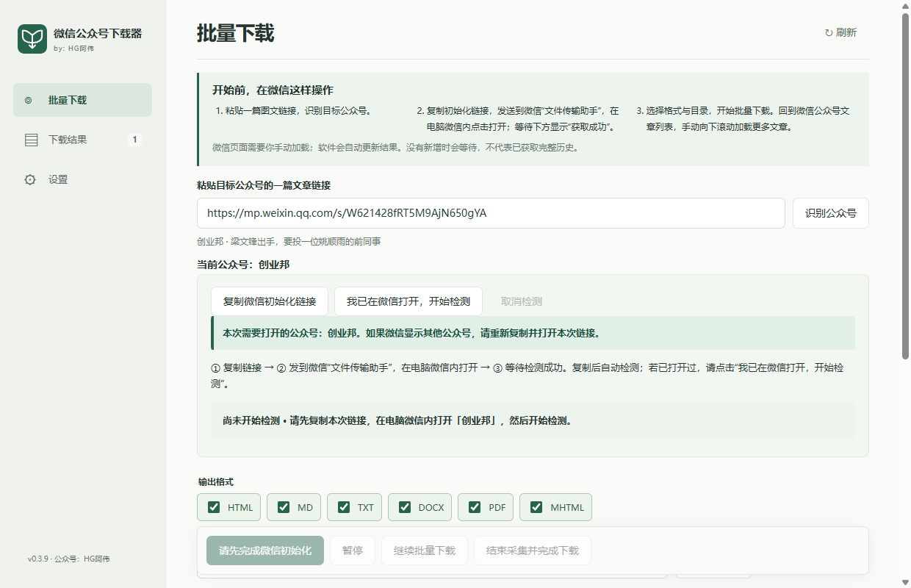
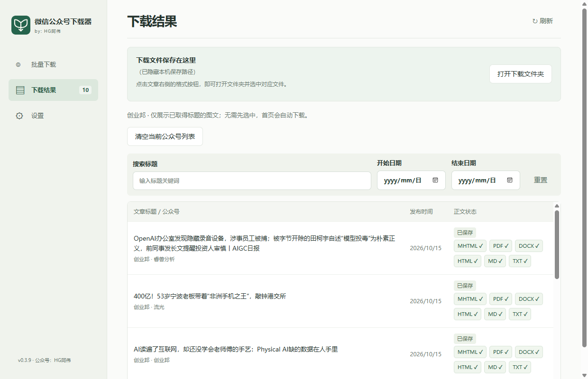

<p align="center">
  
</p>

<h1 align="center">微信公众号下载器</h1>

<p align="center">在微信下拉，文章自动保存。</p>
<p align="center">Windows 10 / 11 · 六种导出格式 · 本地归档 · by HG阿伟</p>

<p align="center">
  <a href="https://www.hgawei.cn/software/b5cf1519-1161-443a-b2da-393d0b79de0f"><strong>前往软件下载页</strong></a>
  · 微信公众号：<strong>HG阿伟</strong>
</p>

> **下载与更新**：前往 [HG阿伟 · 微信公众号下载器](https://www.hgawei.cn/software/b5cf1519-1161-443a-b2da-393d0b79de0f) 查看软件下载信息。在微信中搜索公众号 **「HG阿伟」** 并关注，获取软件更新与使用消息。
>
> 本仓库保留基于 **v0.4.1** 整理的旧版介绍与教程，截图来自 **v0.3.9**；新版说明以软件下载页及实际安装版本为准。

把值得收藏的公众号文章保存到自己的电脑，方便离线阅读、整理资料和继续做笔记。

在电脑微信中打开目标公众号的文章列表，手动向下滚动，软件会发现已加载的图文并依次下载，无需逐篇打开。支持同时导出 HTML、Markdown、TXT、Word、PDF 和 MHTML。

**快速入口：[安装与使用教程](docs/USAGE.md) · [常见问题](docs/FAQ.md)**

> 文章列表需要你在电脑微信中手动加载。发现数量不代表公众号完整历史；当前主要保存图文，视频自动跳过。

## 软件预览





*截图来自项目已有的 v0.3.9 实操教程，以“创业邦”为操作示例。本文依据当前 v0.4.1 项目整理，部分界面文字和新增设置以实际安装版本为准。截图不代表当前版本重新实测结果，也不表示与示例公众号存在合作关系。*

## 适合用来做什么

- **个人阅读归档**：把想留着慢慢看的文章保存下来，方便离线阅读。
- **专题资料整理**：按公众号和文章分文件夹，整理学习、工作和研究资料。
- **笔记与再编辑**：用 Markdown 接入笔记工具，用 Word 继续编辑，用 PDF 阅读或打印。

## 主要功能

| 功能 | 说明 |
| --- | --- |
| 批量保存图文 | 读取微信已加载的文章链接，获取可访问的标题、日期和正文 |
| 六种输出格式 | HTML、Markdown、TXT、DOCX、PDF、MHTML，可同时选择 |
| 本地图片 | 下载正文图片；移动 HTML、Markdown 时保留完整文章目录 |
| 暂停与恢复 | 保留已发现列表和处理记录，继续处理未完成部分 |
| 跳过完整结果 | 已完成且文件仍完整的格式跳过，补选格式时处理缺少的部分 |
| 可选互动数据 | 保存当前可读取的阅读、点赞等统计及公开精选评论、回复 |
| 结果查找 | 按标题和日期筛选，点击成功的格式按钮定位文件 |
| 公众号隔离 | 不同公众号分别保存记录，切换后重新初始化 |

## 下载与安装

请前往 **[软件下载页](https://www.hgawei.cn/software/b5cf1519-1161-443a-b2da-393d0b79de0f)** 获取软件，版本与可用安装包以页面提供的信息为准。本仓库用于软件介绍与使用说明。

下载后，按所提供的包类型操作：

- **安装版**：下载 `*-setup.exe`，安装后从快捷方式启动。
- **便携版**：下载 `*-portable.zip`，完整解压后运行 EXE。

运行环境为 **Windows 10/11 64 位、电脑微信、Microsoft Edge WebView2 Runtime**。需要联网完成启动检查和文章获取，运行软件无需安装 Python、Node.js 或 Rust。

详细步骤见 [安装与使用教程](docs/USAGE.md)。

## 第一次使用

1. 登录电脑微信，复制目标公众号的一篇图文链接。
2. 在软件中粘贴链接，点击“识别公众号”，核对公众号名称。
3. 如需初始化，复制软件提供的初始化链接，发送到微信“文件传输助手”，**在电脑微信内打开**，等待初始化成功。
4. 选择导出格式和保存目录，点击“开始批量下载”。
5. 回到目标公众号文章列表，手动下拉加载更多内容，软件自动发现并保存。
6. 加载到需要的范围后，点击“结束采集并完成下载”，等待已发现队列处理完成。

## 文件保存在哪里

默认首次输出位置为系统“文档”目录下的“微信文章归档”，也可以自行选择保存目录。在“下载结果”页点击“打开下载文件夹”，或点击文章右侧已成功的格式按钮定位文件。

当前源码的新导出目录示例（仅展示已勾选的格式）：

```text
你选择的保存目录/
└─ 公众号名称/
   └─ 文章标题/
      ├─ 文章标题.html
      ├─ 文章标题.md
      ├─ 文章标题.txt
      ├─ 文章标题.docx
      ├─ 文章标题.pdf
      ├─ 文章标题.mhtml
      ├─ images/
      └─ 互动数据.json       # 勾选互动选项时保存
```

旧版文件命名可能不同，已有文件不会自动搬迁或批量改名。新增日期前缀选项等功能是否可用，以安装包实际版本为准。

## 使用边界

- 软件保存的是当前可读取的图文，不能保证获取完整历史、已删除文章或全部评论。
- 遇到微信验证或访问限制时，按提示完成验证或稍后重试；软件不会绕过验证。
- 互动数据是采集时的快照，缺失字段不等于 0；互动失败不代表正文保存失败。
- 请仅保存有权使用的内容，转载或传播前取得原作者授权。

## 反馈与更新

可通过本仓库 Issues（如已开启）或软件中的“给作者留言”反馈问题。建议提供软件版本、Windows 和微信版本、操作步骤及脱敏截图，不要提交会话凭证、Cookie 或私人数据。

**微信搜索公众号「HG阿伟」并关注**，获取软件更新与使用消息，也可以把遇到的问题和使用建议告诉我。

**[前往 HG阿伟 · 微信公众号下载器页面](https://www.hgawei.cn/software/b5cf1519-1161-443a-b2da-393d0b79de0f)**，查看软件下载信息与后续版本说明。
