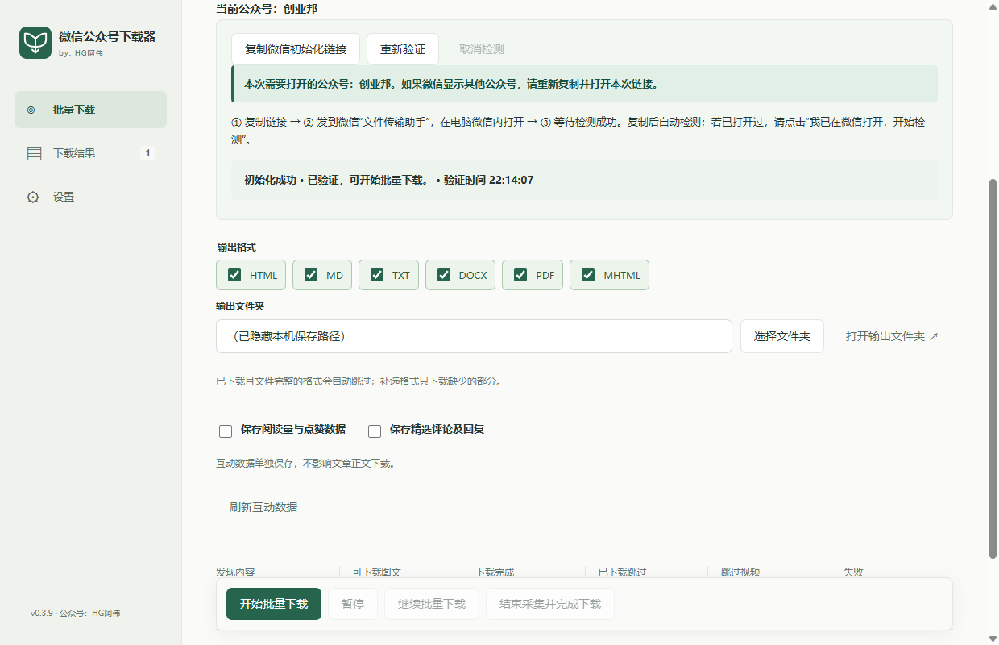
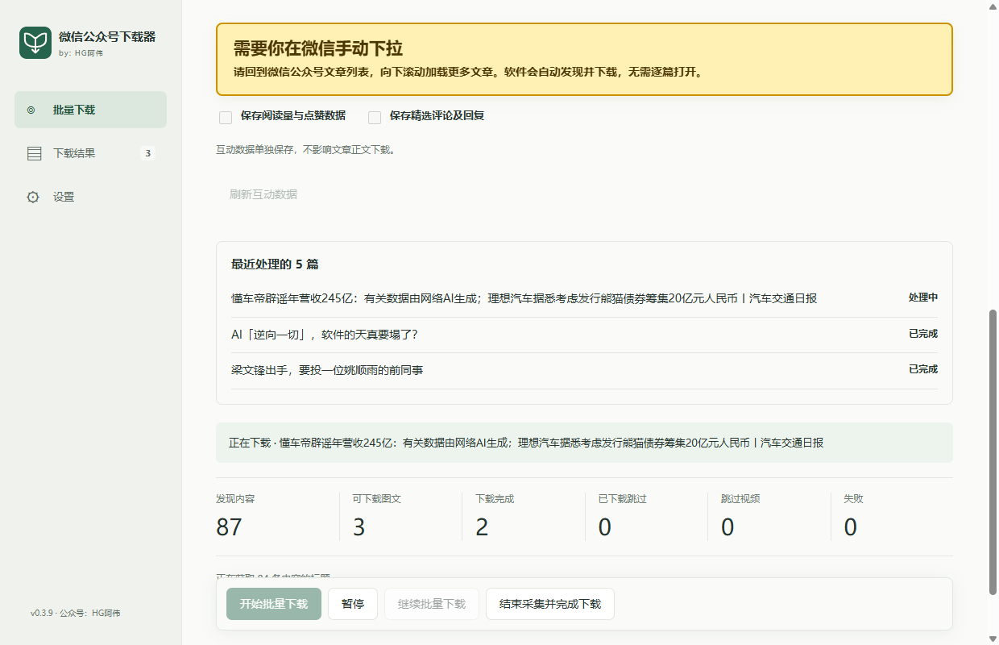

# 安装与使用教程

[软件下载](https://www.hgawei.cn/software/b5cf1519-1161-443a-b2da-393d0b79de0f) · [返回软件介绍](../README.md) · [常见问题](FAQ.md)

> 获取软件请前往上方下载页。微信搜索公众号 **「HG阿伟」** 并关注，获取软件更新与使用消息。以下保留旧版操作教程，新版界面和功能以实际安装版本为准。

本教程依据当前 v0.4.1 项目整理。截图沿用 v0.3.9 实操材料，按钮名称和新增功能以实际安装版本为准。

## 1. 使用前准备

- Windows 10/11 64 位电脑。
- 已登录的电脑微信。
- Microsoft Edge WebView2 Runtime。
- 可用网络，以及具有写入权限、空间充足的保存目录。

每次启动需要在线检查成功后才能使用采集下载。出现普通更新提示时可按界面选择；强制更新时需要先完成更新。离线时不能依靠历史检查结果开始采集。

安装版运行安装程序后，从快捷方式打开“微信公众号下载器”。便携版先完整解压 ZIP，再运行 EXE，不要直接在压缩包内运行。运行软件不需要配置开发环境。

包内如果提供独立数据启动脚本，使用该脚本可能与直接运行 EXE 使用不同的记录目录；日常固定一种启动方式。记录目录和文章输出目录是两个概念，更换记录目录不会自动迁移文章文件。

## 2. 识别目标公众号

在电脑微信中打开目标公众号的一篇图文，通过文章右上角菜单复制链接。

将链接粘贴到软件的“公众号文章链接”输入框，点击“识别公众号”。识别后核对“当前公众号”名称。无法自动识别时再使用手动识别选项。

批量保存时不需要逐篇复制链接，这一步只是确定目标公众号。

## 3. 完成微信初始化

识别后软件会检测已有会话。如仍需初始化：

1. 点击“复制初始化链接”（旧版可能显示“复制微信初始化链接”）。
2. 将链接粘贴并发送到微信“文件传输助手”。
3. **在电脑微信内点击链接**，等待文章页面加载完成。
4. 核对页面属于当前目标公众号，回软件等待初始化成功。
5. 已打开但未成功时，按界面点击“重新检测”或对应的检测入口。

初始化链接需要在电脑微信内打开，外部浏览器或手机微信不能代替这一步。

## 4. 选择格式和保存目录

| 格式 | 建议用途 |
| --- | --- |
| HTML | 用浏览器离线阅读正文与已下载图片 |
| Markdown（MD） | 放进支持 Markdown 的笔记工具，继续整理 |
| TXT | 保存纯文字，方便检索、摘录 |
| DOCX | 用 Word、WPS 打开编辑 |
| PDF | 阅读、打印、长期留存 |
| MHTML | 单文件网页，用支持该格式的软件打开 |

可以同时勾选多种格式。复杂网页排版、嵌入内容和 PDF 分页可能与微信显示不同。

选择容易找到的输出文件夹。需要互动数据时，额外勾选“保存阅读量与点赞数据”或“保存精选评论及回复”，默认均关闭。

## 5. 开始下载并加载文章

初始化成功后，点击“开始批量下载”，回到电脑微信的目标公众号文章列表，手动向下滚动。软件会发现已加载链接，并依次获取、保存可下载图文。

“等待你在微信加载更多文章”表示需要继续下拉。重复加载已发现内容不会增加数量。发现数量包含尚未处理或无法下载的内容，不能当作下载成功数量。

当前源码还区分“正文已保存”和“完整导出完成”：前者表示正文已写入本机记录，图片或文件导出可能仍在处理。判断文件是否可用，应查看对应格式的成功状态。

## 6. 暂停、恢复与结束

| 操作 | 效果 |
| --- | --- |
| 暂停 | 停止当前采集和处理，保留队列与已有结果 |
| 继续批量下载 / 重试未完成文章 | 根据已有记录处理缺少或失败的部分，完整格式跳过 |
| 结束采集并完成下载 | 停止发现新链接，继续处理已经发现的队列 |

恢复已保存的文章列表，不需要为了这些文章重新下拉微信。继续发现新文章仍需加载对应列表。重启后点击继续恢复；需要获取新正文或互动数据时，可能需要重新初始化。

遇到会话失效，按软件提示在电脑微信打开当前公众号文章，再检测或等待接续。手动暂停后需要手动继续。遇到限流或验证时，先按提示处理，再稍后继续，避免连续重试。

“本次已发现文章处理完成”只表示当前队列完成，不代表取得全部历史。

## 7. 查看与移动文件

进入“下载结果”：

- 点击“打开下载文件夹”，查看输出总目录。
- 点击某篇文章已成功的 `HTML`、`PDF`、`DOCX` 等按钮，打开所在文件夹并定位文件。
- 使用标题和日期筛选，查找需要的文章。

默认按“输出目录 / 公众号名称 / 文章标题”组织。HTML、Markdown 可能引用配套图片，移动或备份时保留完整文章目录。

当前源码使用文章标题作为正文文件名，互动文件为“互动数据.json”；早期安装包可能使用不同文件名，包括 `engagement.json`。已有文件不会自动改名。若安装版本提供“文章文件夹名前加发布日期”，在设置中开启并保存后用于新导出，旧文件夹保持原样。

## 8. 保存或补采互动数据

互动数据与正文分开保存，包含当前可读取的统计、公开精选评论和回复，并记录采集时间与状态，不会自动追加到 Word 或 PDF 正文。

正文已保存后也可补选互动选项，再开始或继续。需要更新已有互动结果时，点击“刷新互动数据”，再开始或继续下载；已成功的正文格式会跳过。

数据为采集当时的快照，缺失字段不等于 0。评论可能关闭、仅部分获取或无法读取，不保证全部评论及回复。互动失败不会删除已完成的正文文件。

## 9. 切换公众号与清空列表

切换前先暂停或结束当前任务，再粘贴新公众号图文链接，重新识别、核对名称并完成初始化。不同公众号的初始化不能互相替代。

“清空当前公众号列表”需要确认，会清除当前公众号的列表和相关任务记录，保留已下载文件及其他公众号记录。清空后可能影响后续跳过判断，不要把它当作刷新操作。
